<div align="center">

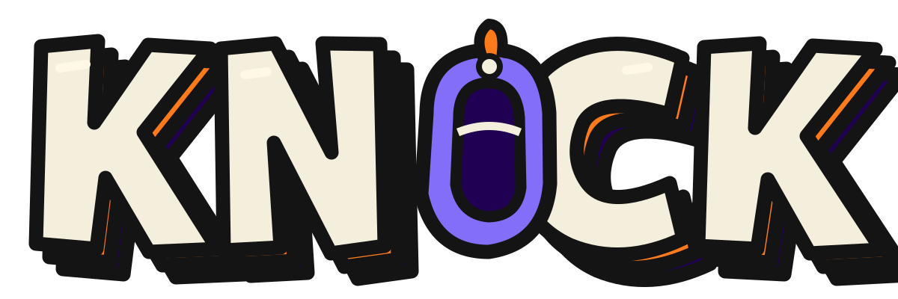

# Knock: Candy Siege

**A Halloween tower defence where all 1,969 Chog Genesis NFTs are playable heroes, and every trick-or-treater at your door is a real Chog.**<br>
Each Chog's real traits decide how it fights, on both sides of the porch. Made for Chogathon 2026.

[Play](https://knock.timidan.xyz) · [Live stats](https://knock.timidan.xyz/stats) · [How Chogs run the game](#take-the-chogs-out-and-there-is-no-game) · [Run it locally](#run-it-locally)


</div>

<a href="https://knock.timidan.xyz">
<picture>
  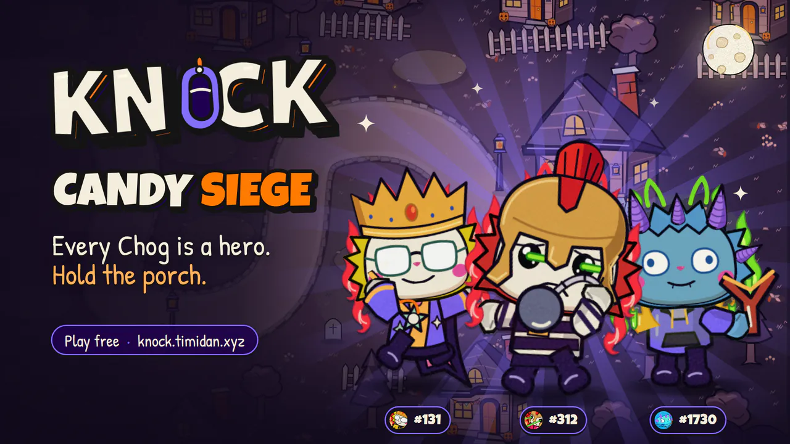
</picture>
</a>

> [!IMPORTANT]
> Knock is free in the browser and needs no wallet or sign-up. On a phone, hold it sideways. The shop's token, $KNOCK, is on Robinhood Chain testnet and has no value. Nothing in the game pays out.

## Take the Chogs out and there is no game

The Chog Genesis collection is the game's rule book. A Chog's traits decide its weapon, its powers and its perks when it defends your porch, and its modifiers when it knocks on your door. The ten 1:1 legends are the bosses. Take the collection away and there are no heroes and no bosses, and the enemies lose their faces and their tricks.

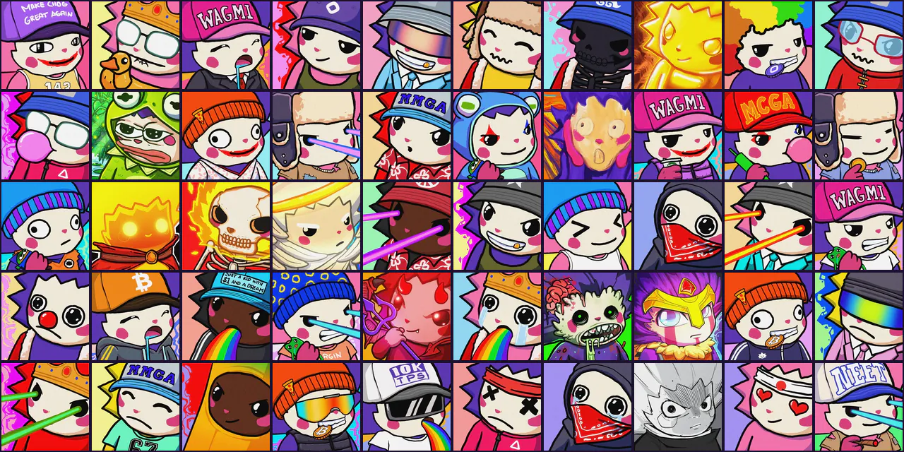
<sub>50 of the 1,969 heroes, including all ten 1:1 legends.</sub>

### Every trait is a rule

Pick any Chog from 1 to 1,969, and the game turns its traits into a full kit:

| Trait | Becomes | Families | For example |
|---|---|---|---|
| **Body** | the weapon (basic attack) | 13 | Wizard gives **Scepter Bolt**, a magic bolt that ignores armour. Stripes gives **Ball & Chain**, melee area damage. |
| **Eyes** | the special | 9 | Teary gives **Tear Flood**, a wave of tears that slows enemies and pushes them back. Laser eyes give **Laser Sweep**: fire burns, green poisons, cyan freezes and purple pierces. |
| **Aura** | the ultimate | 10 | Electric Shock gives **Thunder Chain**, lightning that chains through 12 enemies. The 985 Chogs with no aura get one from their background colour: Sky Blue gives **Twister**. |
| **Mouth** | a passive | 8 | Gold Tooth gives **Money Mouth**, +15% candy from kills. Drooling gives **Sweet Tooth**: the hero heals by collecting dropped candy. |
| **Head** | a headgear perk | 11 | Crown gives **Royal Command**: towers near the hero do 15% more damage. Wizard Hat gives **Spellcraft**, 20% shorter spell cooldowns. |
| **Accessory** | a trinket | 8, or none | Fwog gives **Lucky Frog**: the hero revives once per level. Coin gives **Lucky Coin**, +50 starting candy. |
| **Skin, Form, Base, Tier** | quirks | | Metal skin is armoured. A Skull form revives once. A Radioactive base poisons. Rare, Epic and Legendary Chogs start 1, 2 or 3 hero levels higher. |

The six main slots give **1,766 different kits** across the collection, and Skin, Form, Base and Tier add their quirks on top. The ten legends get hand-made weapons, specials and ultimates.

**One Chog, read by the game.** Chog #175, the hero in the screenshots on this page, has a Stripes body, Normal Eye, no aura on a Sky Blue background, a Drooling mouth and a Crown. That gives it Ball & Chain, Pep Talk, Twister, Sweet Tooth and Royal Command.

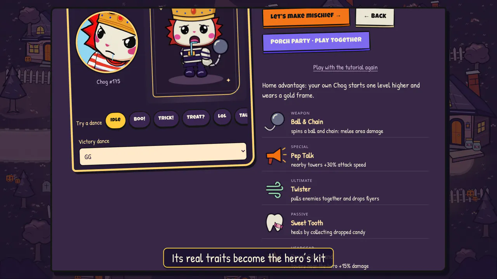

- **Talents follow the traits.** At hero levels 2 to 5 you pick one of two cards. One upgrades a move your traits gave you: the weapon at level 2, the special at 3, the passive or headgear at 4 and the ultimate at 5. The other is a general upgrade.
- **TRAITS ACTIVE.** At the start of each level, a "CHOG #… · TRAITS ACTIVE" card shows the perks your Chog brought. The perk badges then stay at the top left; tap one to read it again.

### Every enemy is a real Chog

Each trick-or-treater wears a costume with a real Chog's face, drawn at random from all 1,969. That Chog's traits become its modifiers, 18 in all. For example:

- laser eyes zap a tower for a 1-second stun;
- a Crown armours nearby friends;
- a Gold Tooth, BTC Coin or Mon coin mouth drops double candy;
- a Drooling mouth steals two jars;
- a Skull form revives once;
- Rare and Epic Chogs have 50% or 100% more health and candy.

Tap any enemy to see its Chog number and its modifiers. If Chog #175 knocks on your door, its Crown armours the enemies around it, and it steals two jars.

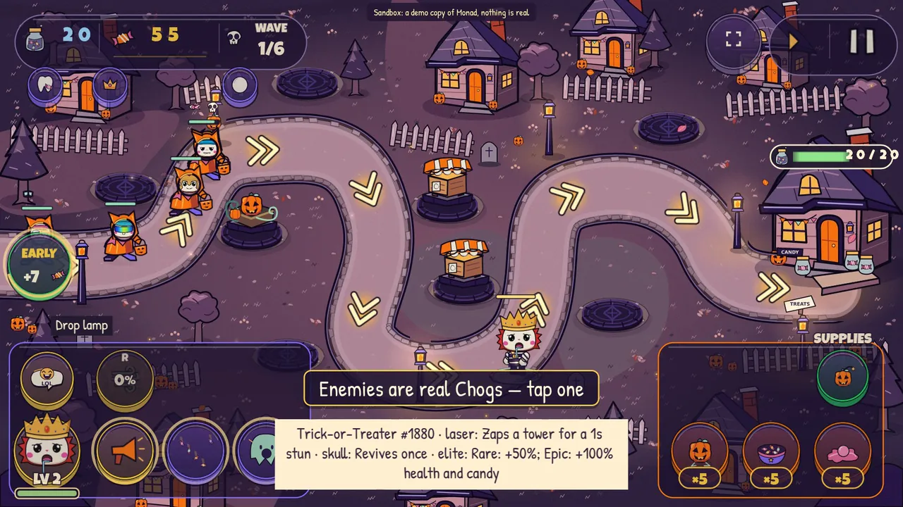

<details>
<summary><b>All 18 enemy modifiers</b> (<code>app/src/siege/data/traits.ts</code>)</summary>

| Trait | Modifier |
|---|---|
| Aura: Burning, Fiery or Fire | Immune to slows |
| Aura: Aqua | Can't be knocked back |
| Aura: Smoke | Dodges 20% of attacks |
| Aura: Wind | 20% faster |
| Eyes: any laser | Zaps a tower for a 1-second stun |
| Eyes: Gradient visor or Anime Glass | Ignores candy lures |
| Head: Crown | Armours nearby friends |
| Head: Wizard Hat | Blinks forward |
| Mouth: Gold Tooth, BTC Coin or Mon coin | Drops double candy |
| Mouth: Bubblegum | Gum slows guards |
| Mouth: Drooling | Steals two jars |
| Accessory: Knife | Shreds guards |
| Accessory: Fwog or PEPE | Survives one lethal hit |
| Accessory: Green or Red Candle | Pumps and dumps its speed |
| Form: Skull | Revives once |
| Base: Radioactive | A poison aura hurts guards and the hero |
| Skin: Metal | Physical armour |
| Tier: Rare or Epic | +50% (Rare) or +100% (Epic) health and candy |

</details>

### The ten legends are the bosses

The ten 1:1 Chogs come to the door as bosses, each with its own move. The Great Pumpkin closes the last night.

| Legend | Boss move |
|---|---|
| Ember (#561) | **Wildfire:** leaves burning footprints that set guards alight; immune to burning |
| Hellfire Skull (#900) | **Hell Ride:** dashes ahead, scattering guards; revives once |
| The Scream (#942) | **The Scream:** the screen warps, and towers miss half their shots for 4 seconds |
| Brainz (#1002) | **Rise Again:** raises fallen enemies to walk the road again |
| Pepe (#1481) | **Frog Leap:** leaps far down the road, shaking off slows |
| Manga (#1514) | **Final Panel:** time stops for your towers for 3 seconds |
| Seraph (#1667) | **Sanctuary:** shields every enemy near it for 5 seconds |
| Gladius (#1798) | **Testudo:** raises its shield and blocks the next five hits |
| Midas (#1881) | **Golden Touch:** turns two towers to gold, silencing them for 5 seconds |
| Lil' Devil (#1884) | **Pact:** steals three jars at once and calls a swarm of imps |

Play a legend as your hero, and it brings its own hand-made weapon, special and ultimate.

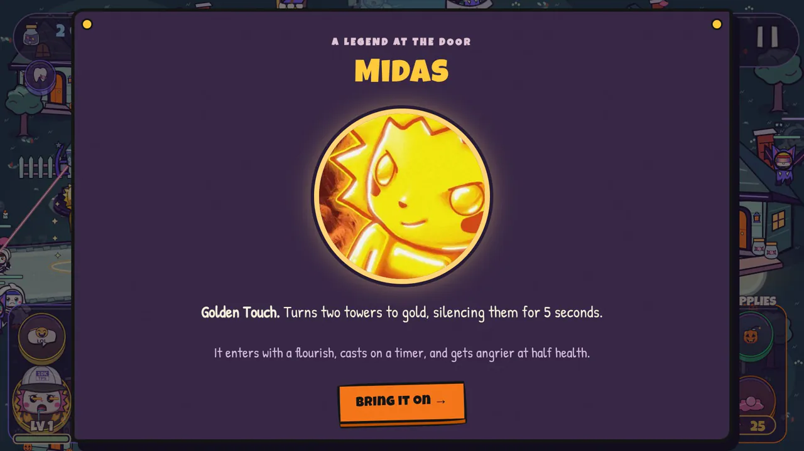

### One rig, 1,969 faces

The hero is a puppet rig: a costume body with the Chog's real portrait as its head. One rig animates all 1,969 portraits. Apart from the ten legends' hand-made costumes, no Chog needs art of its own. Enemies are frame-animated costumes with the portrait in a face window.

Each Chog also has a signature emote that comes from its own mouth or eyes, 18 kinds in all, played on its own face. A Gold Tooth sparkles, crying eyes spray tears, and laser eyes flash beams.

### Owning a Chog matters

- **Home advantage.** Connect the wallet that holds your Chog. The game reads `ownerOf` on Monad, and your own Chog starts one hero level higher and wears a gold frame.
- **The $CHOG perk.** Any $CHOG balance on Monad gives +25 starting candy and 10% more candy from kills. The game only reads the balance; nothing is spent.
- **Porch Party co-op needs a Chog you hold.** The game checks `ownerOf` before you open or join a room.
- **No Chog? Try as a holder.** One tap in the hero picker gives your browser's guest wallet a real Chog, 1,000 $CHOG and 1 MON on a sandbox copy of Monad. You then play with Home advantage and the $CHOG perk. The screen labels the sandbox, and it resets every night at 00:05 UTC.

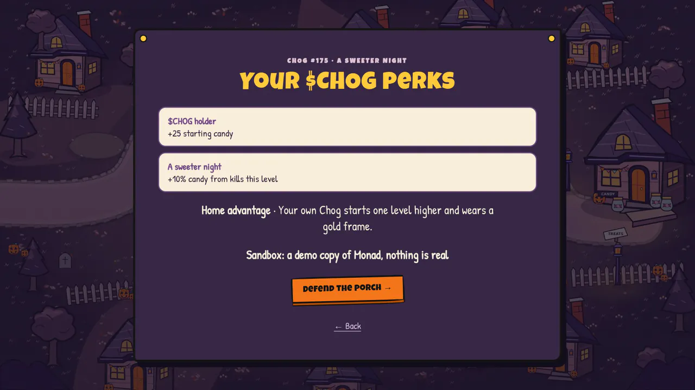

### By the numbers

| 1,969 | 1,766 | 18 | 10 |
|:-:|:-:|:-:|:-:|
| playable heroes, and the faces the enemies wear | different kits from the six main traits | enemy modifiers from traits | legend bosses |

<sub>**Random** and the default hero skip the 312 Chogs whose cap or shirt carries crude text. You can still play any of them by typing its number.</sub>

### See it in 30 seconds

1. Open [knock.timidan.xyz](https://knock.timidan.xyz), tap **Hold the porch →**, then **Rosie Row**.
2. On "Who's on porch duty?", type any Chog number from 1 to 1,969, or tap **Random**. The panel lists the kit its traits give it. To play as a holder, tap **Try as a holder**.
3. Tap **Let's make mischief →**. Your first Rosie Row is a short tutorial; **SKIP** is on its card.
4. Read the **TRAITS ACTIVE** card, then tap any enemy to see which Chog it is.

## How it plays

Enemies walk the road to your house and steal candy jars. You start each night with 20. A bar on the house shows how many are left, and when the last jar goes, the porch falls.

- **Towers.** Build on stone pads. There are four families: Egg Stand, TP Launcher, Haunted Lantern and Pumpkin Patch. Each has three levels, two specialisations and two more ranks. Four special towers unlock as you win, and a fifth, the Bat Roost, is in the shop.
- **Your hero.** Move it, and it attacks on its own. Fire its special and its ultimate, and pick a talent at each hero level.
- **Traps, supplies and spells.** Three traps and five supplies, with 5 uses of each per level, and two spells: Candy Rain and Boo!
- **Waves.** Ghosts hide, pumpkins resist eggs, bats fly, goblins steal three jars, witches heal, mummies split and skeletons come in fives. Witching Hour waves pour ghosts and bats in from the screen edges. Legends and the Great Pumpkin arrive as bosses. Call a wave early for bonus candy.
- **Stars.** 3 stars for 18 to 20 jars left, 2 for 10 to 17, and 1 for 1 to 9. A win with 2 stars or more unlocks the next night.
- **Six nights, Endless and the Daily.** The nights are Rosie Row, Lemon Lane, Mint Mews, Mon Manor, Radioactive Ridge and Rare Row. Each map has its own twist (two roads, a canal bridge, portals, toxic pools, darkness) and a prop you tap, and later nights are harder. A 2-star win on Rosie Row also opens Endless, on Town Square, which adds a road every 10 waves and a boss every 10th wave. It opens the Daily too: the UTC date picks a map and a night (Quiet night, Blood Moon, Candy Rain or Costume Night).
- **It teaches itself.** A 7-step tutorial with a pointing glove, a card for each new enemy, one-time rule callouts (ARMOURED, HIDDEN, FLYING), a preview of the next wave's path, and a porch alarm when a jar is stolen.

<details>
<summary><b>Everything else</b></summary>

- **Speed:** 1×, 2× or 3×, and a field guide.
- **Emotes:** 8 for everyone, plus your Chog's signature.
- **Feedback:** hit flashes; BLOCK!, CRIT!, MISS and TINK pops; candy flying to the counter; a letterboxed boss entrance; and a star-slam result screen.
- **Sound:** menu, level and boss music. Every game action and menu press has its own sound, and each game sound has a layer above 500 Hz so that phone speakers play it.
- **Sharing:** a 1080×1350 share card with your Chog, stars, score and one accolade: **BOSS SLAYER** after a win in which a boss fell, **PERFECT DEFENSE** for a win with all 20 jars, or else the number of Chogs stopped. The [stats page](https://knock.timidan.xyz/stats) has a community goal of 100,000 monsters stopped and a share image of it.
- **Settings:** music and effects volume, Lite mode, screen shake, vibration (Android), full screen on Play, golden towers and a stats opt-out. Reduced-motion preferences are respected.
- **Desktop:** hovering a hero power, spell, perk badge, trap or supply shows a one-line tip. Keys: Space pause, 1 and 2 spells, Q special, R ultimate, Z and X talents, E emotes, N next wave.

</details>

The [player guide](docs/HOLDERS.md) covers every mode in more detail.

## Porch Party co-op

Two holders, one porch. Each player brings a Chog they hold, with its own kit, special, ultimate and talents. Candy, towers, traps, spells and jars are shared, so you agree on what to build, and a talent pick pauses both games. Open a room from the hero picker on any night you've unlocked, and send the invite link.

Both browsers run the whole game in deterministic lockstep. A small relay passes the inputs in a fixed order and compares state hashes. No server runs the game.

**Try it alone:** in one browser, tap **Try as a holder**, then **Porch Party · play together**, and copy the invite. Open the link in a second browser or a private window, tap **Try as a holder**, then **Join Porch Party →**.

## The Candy Vault

The Candy Vault is the shop. It sells cosmetics and small conveniences for $KNOCK, a token on Robinhood Chain testnet. The shop reads every price from the KnockShop contract:

| Item | Price |
|---|---|
| Dances: Floss, Dab, Moonwalk, Robot, Chicken, Breakdance, Disco and Worm | 150 $KNOCK each |
| Crew costumes: ghosts, witches, pumpkins and bats | 400 $KNOCK each |
| Golden towers | 600 $KNOCK |
| Crypto emote pack | 300 $KNOCK |
| A sweeter start: +50 starting candy | 200 $KNOCK |
| Bat Roost tower | 400 $KNOCK |

- **A 300 $KNOCK starter grant,** once per wallet, with a little test ETH for gas. A guest wallet made in the browser can claim it and buy, with no extension.
- **One signature, one transaction.** A purchase is a `permit` signature for the exact price, then one `buyFor` call that only the buyer can send. Ownership is on-chain, so it follows the wallet.
- **Playing never earns $KNOCK.** A score from a browser can be faked, so the game pays nothing out.

## Screenshots

<table>
  <tr>
    <td width="50%">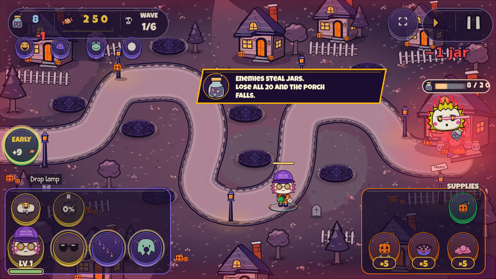<br><sub>Enemies steal jars. The bar on the house shows 8 of 20 left.</sub></td>
    <td width="50%">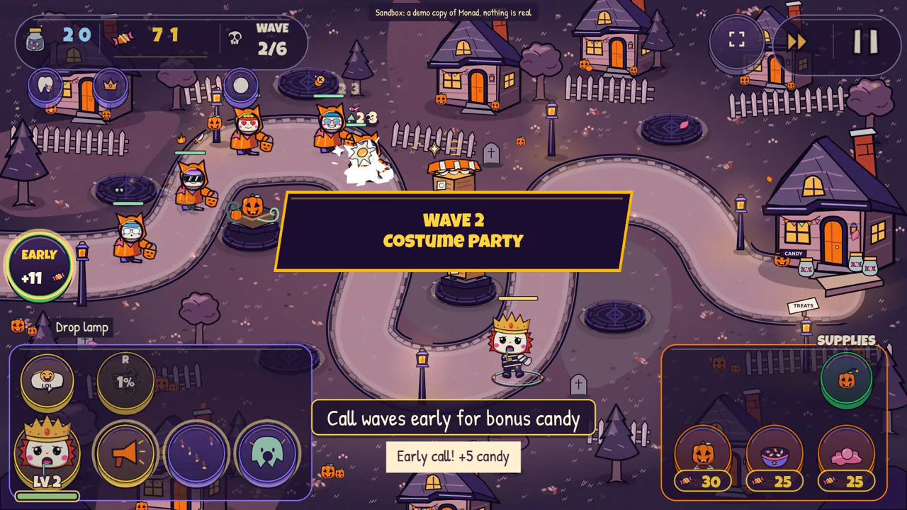<br><sub>Calling a wave early pays bonus candy.</sub></td>
  </tr>
  <tr>
    <td width="50%">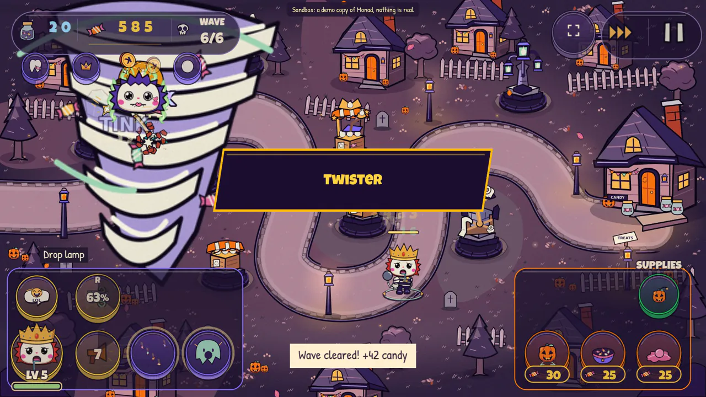<br><sub>Twister, the ultimate Chog #175 gets from its Sky Blue background.</sub></td>
    <td width="50%">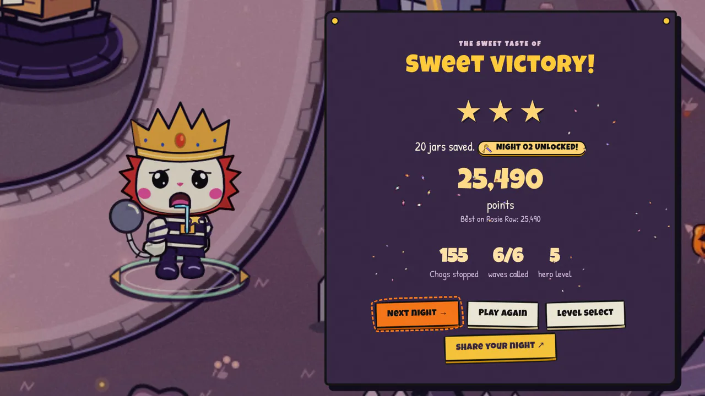<br><sub>A 3-star win with all 20 jars unlocks the next night.</sub></td>
  </tr>
</table>

## Under the hood

- **Stack:** TypeScript, Phaser 3.90 for the game world and HUD, React 19 for the menus, shop and overlays, and viem for chain reads and testnet purchases. The game runs in the browser, and progress is saved there.
- **A deterministic simulation.** The game advances in fixed 1/45-second steps. One seeded random stream drives gameplay and a separate one drives visuals, so effects never change the outcome. Every input goes through one `command()` entry point.
- **Lockstep co-op.** Both browsers run the whole simulation from one seed. Each command is scheduled a fixed number of ticks ahead, set per match from eight round-trip probes, and passes through a Cloudflare Durable Object, one per room. Every 2 seconds both games hash their state, and the relay compares the hashes; a mismatch stops the match. There is no prediction or rollback.
- **Content is data.** `kits.json`, `traits.json` and `legends.json` map the collection to the rules, and `scripts/rig-check.mts` checks all 1,969 kits.
- **Performance.** About 60 fps with 60 enemies and 12 towers firing, measured in Chrome on an Intel Iris Xe laptop GPU at a phone-sized viewport. A quality governor and a Lite mode help slower devices. It hasn't been measured on a physical phone yet.

| Service | Built on | Job |
|---|---|---|
| Game | Cloudflare Pages | Serves knock.timidan.xyz |
| Co-op relay | Cloudflare Worker with Durable Objects | One object per Porch Party room: orders inputs and compares state hashes |
| Candy Bank | Cloudflare Worker with D1 | Queues starter-grant claims, with rate limits |
| Grant relay | Node, no inbound ports | Pays queued grants on Robinhood Chain testnet |
| Holder sandbox | anvil fork of Monad mainnet | Gives "Try as a holder" its Chog and $CHOG |
| Live stats | Cloudflare Worker with D1 | Counts anonymous play events for `/stats` |

The stats store no wallet or IP address, and players can opt out in Settings. Limits, contract addresses and the full privacy note are in [docs/DEVELOPMENT.md](docs/DEVELOPMENT.md).

## Run it locally

You need Node.js 20.19 or newer and ImageMagick (`magick`). The Chog portraits aren't in git, so fetch them once:

```sh
cd app
npm install
node scripts/snapshot.mjs images   # 512 px portraits from IPFS into public/chogs/
node scripts/thumbs256.mjs         # 256 px copies into public/chogs-256/
npm run dev
```

In dev mode the shop is preview-only, and the starter grant and stats are off. Builds, configuration, services, contracts, checks and the repository layout are in **[docs/DEVELOPMENT.md](docs/DEVELOPMENT.md)**.

## Credits

- **Chog art and traits** come from the Chog Genesis collection (`0xc96d…3763` on Monad). The game reads them and never changes them. Portraits are fetched from the collection's IPFS images.
- **Audio** is all CC0 (public domain). It is credited with thanks, not as a licence condition.
  - **Sound effects:** Kenney ([kenney.nl](https://kenney.nl)): Interface Sounds, Impact Sounds, UI Audio, RPG Audio, Music Jingles and Casino Audio.
  - **Music,** from OpenGameArt.org:
    - "Halloween Hullabaloo" by starlightfrost (levels);
    - "A Wonderful Nightmare" by spiderdave (bosses);
    - "Caper" by pro-sensory (menus);
    - "Ghosts in the Machine" by ruskerdax (included, not currently played).
- **Fonts:** Luckiest Guy and Patrick Hand, from Google Fonts.
- **Built with** Phaser, React, Vite and viem.
